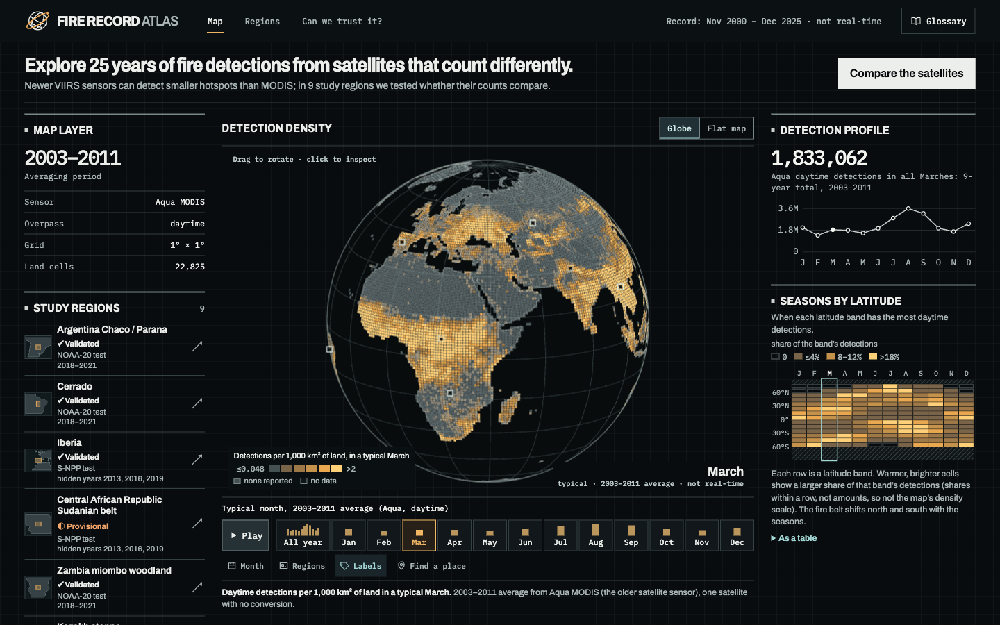

# Fire Record Atlas

**Explore 25 years of satellite fire detections, and see how far you can trust a comparison when the satellite changes.**

**Live site:** https://rajapanreturns.github.io/fire-record-atlas/



## The problem

NASA satellites have recorded hotspots (pixels flagged as unusually hot, usually because something is burning) since 2000.

The long record comes from the **MODIS** sensors on NASA's Terra and Aqua satellites. Those satellites are near the end of their missions. Newer **VIIRS** sensors are taking over.

VIIRS sees the ground in sharper detail, so it picks up smaller and cooler fires that MODIS misses. In the same place and month, VIIRS often reports several times more hotspots.

So the raw counts cannot be put side by side. A jump from MODIS to VIIRS could look like a surge in burning when nothing changed except the satellite.

## What Atlas does

- **Global globe.** See where and when Aqua MODIS detected hotspots in a typical month, 2003–2011, per 1,000 km² of land.
- **Burning calendars.** For nine study regions, see which months usually have the most detections, and the usual range for each month.
- **Is this year normal?** Compare any year's months with the usual range: above, within or below.
- **VIIRS on MODIS's scale.** Switch on a dashed line showing VIIRS counts converted to what Aqua MODIS would likely have reported, with a likely range.
- **Months Aqua missed.** In some regions, a few months when Aqua had an outage are estimated from VIIRS. They are always marked as estimates, never as measurements, and they cannot be checked.
- **Satellite Time Machine.** Take a real month that was hidden from the method. See the raw VIIRS count, convert it, then reveal what Aqua actually measured.
- **Evidence.** Every test month, hits and misses, is one click away.

## How the science works

1. **Find overlap.** For years when both satellites were watching the same region, compare their monthly counts.
2. **Learn the ratio.** Work out how many VIIRS detections typically correspond to one Aqua detection. This ratio is set separately for each region and calendar month, because it changes with the kind of burning.
3. **Convert.** Divide a VIIRS count by that ratio to get an Aqua-equivalent estimate. Attach a 90% likely range, because the ratio is not exact.
4. **Test honestly.** Hide some real Aqua months, convert VIIRS for those months without looking at Aqua, then check the hidden values. The test plans and pass marks were written down before the tests ran.

All counts are daytime, monthly totals of hotspot detections.

## What we found

**Main test: NOAA-20 VIIRS, five regions, April 2018 – December 2021.** None of these five regions was used to build the method. Each test year was hidden in turn.

- **200 of 215** hidden months landed inside the 90% likely range.
- **186 of 204** months got the same verdict as Aqua (above, within or below the usual range), in the months where a verdict was possible. Raw, unconverted VIIRS got it right in only 50 of 204.
- The average error, measured on a log scale, was **71% smaller** than a simple guess: the same region's average for that calendar month in the other test years. The 95% confidence range is 63–78%.

These results apply to those five regions, that period and daytime data only. They are not a guarantee for other places or later years.

**Earlier test: S-NPP VIIRS, four regions, hidden years 2013, 2016 and 2019.**
- Northern Australia and Iberia passed.
- **Punjab–Haryana** and the **Central African Republic** did not pass every check, so their conversions are marked **provisional**. Aqua's own measurements there are not affected.

## Why it matters

1. **Filling gaps.** For a month when MODIS has no data, VIIRS can give an estimate with a stated likely range. These estimates are always labelled, and because there is no MODIS value they cannot be checked directly.
2. **Keeping the long record comparable.** When MODIS stops, a tested conversion could help compare new VIIRS months with 25 years of MODIS history. Using it after MODIS ends still needs further validation.

Atlas looks back at past detections. It does not forecast fires.

## Try it

1. Open the live site and pick a month under the globe.
2. In **Study regions**, choose a region, for example **Mainland SE Asia**. You will see its burning calendar for that month.
3. Click **+ VIIRS on Aqua's scale** to add the converted VIIRS line.
4. Click **Compare the satellites here →** to open the Satellite Time Machine. Press **Harmonize**, then **Reveal Aqua**.
5. Try **Try another test month** or **See a miss**. Open **Explore the evidence** for the full record of that region.

The **Compare the satellites** button on the home page goes straight to the Time Machine.

## Run locally

You need **Python 3.9 or newer**, with no packages to install.

```bash
git clone https://github.com/Rajapanreturns/fire-record-atlas.git
cd fire-record-atlas
python3 scripts/serve.py --port 8000 --dir site
# open http://localhost:8000/
```

For the tests and the static build you also need **Node 18 or newer** and `make`:

```bash
make test    # site tests, then a check of the data files
make build   # writes the static site to dist/
```

## What is in this repository

- `site/`: the whole web app.
  - `js/`, `css/` and `index.html`: plain JavaScript modules, no build step.
  - `vendor/`: d3, topojson and fonts.
  - `data/`: the published monthly aggregates and test results the app reads.
- `site/data-fixtures/`: synthetic test data, used only by the tests and not deployed.
- `contracts/`: data schemas and the data checker.
- `tests/site/`: the site's tests.
- `scripts/serve.py`: the local server.

The processing pipeline that turned NASA's raw archives into `site/data/`, and the research and evaluation code, are kept in the project's private research repository. This repository lets you run and inspect the app and its published results. It does not, by itself, reproduce the scientific analysis.

## Data sources and credits

- **NASA FIRMS** (Fire Information for Resource Management System), standard archive. MODIS Collection 6.1 (MCD14ML), VIIRS 375 m S-NPP (VNP14IMGTML) and NOAA-20 (VJ114IMGTML), 2000–2025. https://firms.modaps.eosdis.nasa.gov/
  > We acknowledge the use of imagery from the NASA LANCE FIRMS (https://earthdata.nasa.gov/firms), part of the NASA Earth Science Data and Information System (ESDIS).
- **Algorithm references.** Giglio, Schroeder & Hall, *MODIS Collection 6/6.1 Active Fire Product User's Guide*; Schroeder, Giglio & Hall, *VIIRS 375 m Active Fire User Guide*; Schroeder et al. (2014), *Remote Sensing of Environment* 143, 85–96, https://doi.org/10.1016/j.rse.2013.12.008.
- **Natural Earth** land data (public domain), https://www.naturalearthdata.com/, via the world-atlas package.
- **Software:** d3 and topojson-client (ISC licence); Archivo, IBM Plex Mono and Source Serif 4 fonts (SIL Open Font License). Licence texts are in `site/vendor/`.

NASA data are not owned by this project. See `NOTICE` for what the licence does and does not cover.

## Limitations

- **Detections are not fires.** A hotspot is a hot pixel at the moment a satellite passed over. It is not a count of separate fires, burned area, damage or fire risk.
- **Tested only where stated.** Each region's conversion is tested only for its own satellite and period. Other places, night-time and the newest satellite (NOAA-21) are untested.
- **Aqua's orbit drifts.** Aqua's orbit has been drifting since 2021, so it passes over later in the day. Comparisons from 2022 on are marked untested.
- **Provisional regions.** Punjab–Haryana and the Central African Republic did not pass every check.
- **Missing is not zero.** Months without data are shown as missing, never as zero detections.
- **Study boxes are approximate.** For example, the "Argentina Chaco / Parana" box lies mostly in Paraguay.

## Development and AI assistance

Atlas was built for the NASA Space Apps Challenge 2026 (November 14–15).

**Work began before the event.**
- Research notes date from 5–6 November 2026.
- Implementation started on 9 November.
- The first code commit is dated 10 November.

We were told by someone involved with the event that starting early was allowed, but we do not have this in writing. It needs confirmation from the organizers. This public repository was created as a clean copy with a fresh first commit, so that internal research files are not published. The full development history, with dated commits, is kept in the private research repository and can be shared with the organizers.

**AI assistance.** The project was built with extensive help from Anthropic's **Claude Code**.
- **What the AI did:**
  - wrote most of the code and tests;
  - drafted the documentation, including this README;
  - searched and summarized sources;
  - acted as an independent reviewer of the science, the interface and the release.
- **What the project lead did:**
  - set the goals;
  - wrote the requirements for each stage;
  - made the scientific and design decisions, including approving each test plan before it ran;
  - reviewed the results.
- **What the AI did not do:** generate any data values. Every number comes from NASA FIRMS files processed by code, and the test results come from single, logged runs.

## License

The original code and documentation are under the Apache License 2.0 (`LICENSE`). Third-party data, software and fonts keep their own terms (`NOTICE`).
